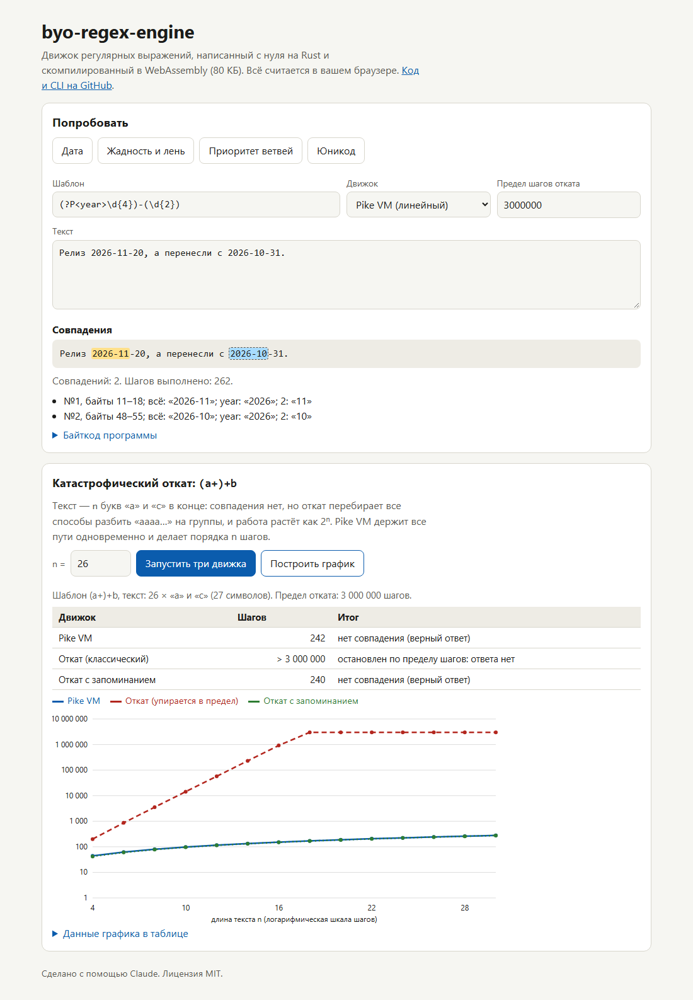

# byo-regex-engine

[](https://github.com/Oleg4311/byo-regex-engine/actions/workflows/ci.yml)
[Песочница онлайн](https://oleg4311.github.io/byo-regex-engine/) · [Релизы](https://github.com/Oleg4311/byo-regex-engine/releases)

**Движок регулярных выражений, написанный с нуля на Rust:** разбор → байткод → виртуальная машина Пайка (Pike VM) за линейное время. Рядом — классический откат, на котором видно, почему `(a+)+b` способен «повесить» сервер. Собирается в WebAssembly (80 КБ), работает в браузере и как CLI `bre`.



*English: a from-scratch regex engine in Rust — parser, bytecode compiler, Pike VM (linear time) and a classic backtracker for contrast, differentially tested against the `regex` crate on random patterns. WASM playground + CLI. See the [English section](#english).*

## Зачем

Почти все языки сопоставляют регулярки откатом (Perl, Python, Java, JavaScript). На плохом шаблоне и подходящем тексте время растёт как 2ⁿ: уязвимость ReDoS. Есть другой способ: моделировать все пути одновременно (Томпсон, Пайк). Этот проект реализует оба и показывает разницу на одном и том же шаблоне:

| | `(a+)+b` на 26 × «a» + «c» |
|---|---|
| Pike VM | ≈ 240 шагов |
| откат с запоминанием | ≈ 240 шагов |
| классический откат | > 3 000 000 шагов (остановлен по пределу) |

## Как устроен

```
шаблон ──parse──▶ дерево (Node) ──compile──▶ байткод (Inst) ──┬─▶ Pike VM            (линейное время)
                                                              ├─▶ откат              (классический, с пределом шагов)
                                                              └─▶ откат с запоминанием (BitState, как в RE2)
```

- **Разбор** ([src/parse.rs](src/parse.rs)): рекурсивный спуск. Понятные ошибки с позицией, предел вложенности (250) и счётных повторов (`{n,m}` до 1000), предел размера программы: враждебный шаблон не переполнит стек и память.
- **Компиляция** ([src/program.rs](src/program.rs)): в 8 инструкций: `Char`, `Class`, `Split` (порядок веток = приоритет, так выражается жадность и лень), `Jmp`, `Save`, `Assert`, `EmptyCheck`, `Match`. `bre --explain 'a(b|c)*d'` печатает листинг.
- **Pike VM** ([src/pike.rs](src/pike.rs)): по одному символу текста все потоки идут параллельно; порядок потоков в списке — приоритет, поэтому ответ тот же, что у Perl: «первое слева, первое по приоритету». Захваты копируются вместе с потоком, обход замыканий — на явном стеке без рекурсии. Время O(текст × программа).
- **Откат** ([src/backtrack.rs](src/backtrack.rs)): жадный перебор с возвратом, счётчик шагов и предел. В режиме «с запоминанием» запоминает пары (инструкция, позиция) и тоже работает за полином, с тем же ответом, что у Pike.
- **Циклы над пустым телом** (`(a*)*`): итерация без продвижения завершает цикл, как в Perl и RE2; без этого цикл не закончился бы.

## Синтаксис

Литералы, `.`, классы `[a-z]`, `[^...]`, `[\d_]`, `\d \D \w \W \s \S`, `\b \B`, `^ $`, группы `(...)`, `(?:...)`, `(?P<имя>...)`, `(?<имя>...)`, альтернатива `|`, квантификаторы `* + ? {n} {n,} {n,m}` и их ленивые версии (`*?`), escape-последовательности `\n \t \xHH \.`. Текст — Unicode (символ — один скаляр, смещения в байтах UTF-8).

**Не поддерживается** (и не может быть выполнено за линейное время или не нужно учебному движку): обратные ссылки, просмотр вперёд и назад, флаги `(?i)`, классы `[[:alpha:]]` и `\p{...}`.

## Использование

**Библиотека:**

```rust
use byo_regex::{Engine, Limits, Regex, Stats};

let re = Regex::new(r"(?P<year>\d{4})-(?P<month>\d{2})")?;
let caps = re.captures("дата: 2026-11-20").unwrap();
assert_eq!(caps.name("year").unwrap().as_str(), "2026");
assert_eq!(&caps[2], "11");

// выбрать движок и посчитать шаги
let evil = Regex::new("(a+)+b")?;
let mut stats = Stats::default();
let backtrack = Engine::Backtrack(Limits { max_steps: 1_000_000, memoize: false });
assert!(evil.captures_with(&format!("{}c", "a".repeat(30)), backtrack, &mut stats).is_err()); // предел шагов
```

**CLI `bre`** (бинарники для Linux, macOS, Windows на странице [Releases](https://github.com/Oleg4311/byo-regex-engine/releases)):

```bash
bre -on '\d{4}-\d{2}-\d{2}' app.log         # только совпавшее, с номерами строк
bre --explain 'a(b|c)*d'                    # байткод
bre --engine backtrack --stats '(a+)+b' f   # откат со счётчиком шагов (код 2, если упёрся в предел)
```

**WebAssembly:** [site-src/app.js](site-src/app.js) показывает, как вызвать модуль без `wasm-bindgen`: три функции `alloc`, `dealloc`, `analyze` и JSON в линейной памяти ([src/wasm.rs](src/wasm.rs)).

## Что проверено

- **Сверка с крейтом `regex` на случайных шаблонах** ([tests/differential.rs](tests/differential.rs)): шаблоны собираются по грамматике (классы, группы, альтернативы, все виды квантификаторов, якоря), тексты случайные. 6 свойств по **5000 случаев** в CI: границы совпадения и **все группы захвата** совпадают с крейтом; итерация по всем совпадениям (включая пустые) совпадает; принятие и отвержение синтаксиса совпадают; Pike и откат с запоминанием совпадают друг с другом; классический откат совпадает с ними там, где нет циклов над возможно пустым телом; произвольный мусор вместо шаблона не вызывает паники.
- **Что нашла сверка, а я не видел сам:** поиск прекращался, если стартовый поток сразу умирал (шаблоны, начинающиеся с `\b`, `$`); `(a*)*` на «b» давал неверную группу; крейт принимает `a**` и `^*`; нумерация групп при `{0}`. Всё исправлено, различия задокументированы тестами.
- **Тесты-примеры** ([tests/basic.rs](tests/basic.rs)): таблица из 44 случаев, каждый одновременно сверяется с крейтом, чтобы не «закрепить» неверное ожидание; приоритет альтернатив; ленивость; юникод; пределы ресурсов (вложенность 10 000 скобок, `((a{1000}){1000}){1000}`, текст на 400 КБ); линейный рост шагов Pike (удвоили текст — шагов вдвое больше).
- **Мутационная проверка:** убирали по одной вещи (продолжение поиска при пустом списке потоков, порядок жадности, отсечение низших приоритетов после совпадения, завершение пустой итерации цикла, `_` как символ слова, запоминание в откате) — тесты падают.
- **Песочница:** 24 браузерных теста (десктоп и мобильный), в том числе доступность (axe) в светлой и тёмной теме, юникод-подсветка по символам, а не байтам, и проверка, что введённый текст не превращается в разметку.
- CI: `cargo fmt --check`, `clippy -D warnings`, тесты на Linux/Windows/macOS, сборка на минимальной версии Rust 1.82.

## Скорость и честные ограничения

Это учебный движок: Pike VM без DFA и без поиска по литеральным префиксам. Сравнение с промышленным `regex` (`cargo run --release --example bench`, ноутбук разработчика, Windows):

| шаблон | byo-regex, МБ/с | regex, МБ/с | медленнее в |
|---|---|---|---|
| `\d{4}-\d{2}-\d{2}` | 4,4 | 1328 | 301× |
| `[a-z0-9]+@[a-z]+\.com` | 4,4 | 609 | 140× |
| `GET\|POST\|PUT\|DELETE` | 2,9 | 2176 | 738× |
| `(foo\|bar)+baz`, нет совпадений | 4,9 | 9779 | 1998× |

Время растёт линейно с длиной текста, но константа большая: копирование массива захватов для каждого потока, нет мемоизации состояний. Для настоящей работы берите `regex`.

- **`\w`, `\d`, `\s`, `\b` — только ASCII.** В крейте `regex` они Unicode. На не-ASCII тексте (`жук` не слово для `\w`) результаты отличаются; сверка идёт на ASCII-текстах.
- **Классический откат — семантика Perl.** В вырожденных циклах над возможно пустым телом (`(.?)*`, `(a|b*)*`) он может вернуть другие границы, чем Pike и крейт; откат с запоминанием совпадает всегда.
- **Нет обратных ссылок, просмотра, флагов, `\p{...}`** (см. выше). `{n,m}` до 1000.
- **Позиции — байты UTF-8**, как в Rust; песочница пересчитывает их в индексы JS.

## Разработка

```bash
cargo test                                  # примеры и сверка с regex (256 случаев на свойство)
PROPTEST_CASES=5000 cargo test              # как в CI
cargo clippy --all-targets -- -D warnings
cargo run --release --example bench
rustup target add wasm32-unknown-unknown && npm ci && npm run e2e   # песочница + браузерные тесты
```

Релизы (`v*`) собираются на трёх ОС, содержат контрольные суммы и подтверждение происхождения: `gh attestation verify bre-v0.1.0-linux-amd64.tar.gz --repo Oleg4311/byo-regex-engine`.

Лицензия: MIT. Сделано с помощью Claude.

---

## English

**byo-regex-engine** is a regular-expression engine built from scratch in Rust: parser → bytecode compiler → **Pike VM** (all threads in lockstep, O(text × program), no catastrophic backtracking) plus a classic **backtracker** (with a step limit) and a memoizing backtracker (RE2's BitState idea). On `(a+)+b` against 26 `a`s the backtracker exceeds 3,000,000 steps; Pike needs ≈240.

- **Differentially tested against the `regex` crate**: 6 properties × 5,000 random grammar-generated patterns — match span, every capture group, iteration over all (including empty) matches, syntax acceptance — plus three-engine agreement and a no-panic fuzz of arbitrary strings.
- Resource limits: nesting depth, `{n,m}` ≤ 1000, program size cap; deep nesting returns an error instead of overflowing the stack.
- Mutation-tested; WASM build (80 KB, no wasm-bindgen: three C-ABI functions + JSON) with an accessible playground (24 browser tests incl. axe).
- Honest limits: a teaching engine, 140–2000× slower than `regex`; ASCII-only `\w \d \s \b`; no backreferences, lookaround, flags, or `\p{…}`.

```rust
let re = byo_regex::Regex::new(r"(?P<year>\d{4})-(\d{2})")?;
let caps = re.captures("2026-11").unwrap();
assert_eq!(caps.name("year").unwrap().as_str(), "2026");
```

Release artifacts carry SHA-256 sums and build provenance (`gh attestation verify`). MIT licensed. Built with Claude.
